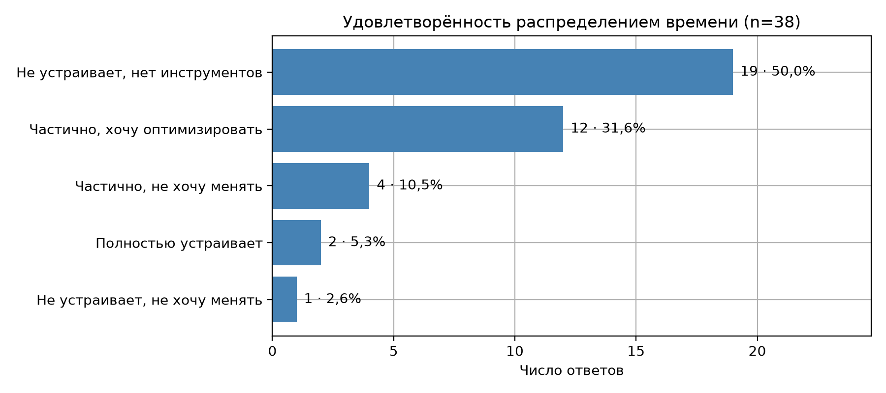
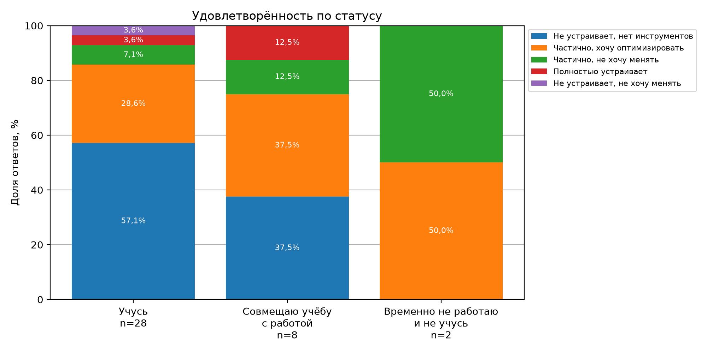
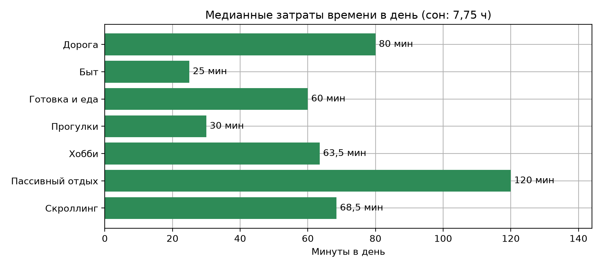
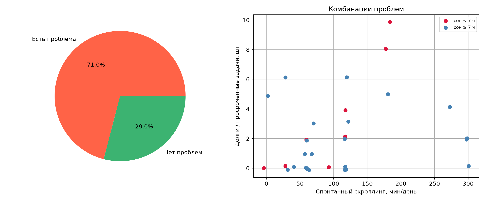

# Анализ данных

## Данные

Источник — опрос о распределении времени, проведённый 30–31 октября 2026 года. 
Получено 38 ответов, 17 полей: статус, возраст, затраты времени на дорогу, быт, готовку и еду, сон, выполнение одной типовой задачи,
прогулки, хобби, осознанный пассивный отдых и спонтанный скроллинг, количество просроченных задач, самооценка продуктивности,
удовлетворённость распределением времени и свободное поле для своих дел.

## Очистка

Числовые аномалии обрабатывает скрипт `data_cleaner` по пяти правилам:

- возраст больше 100 лет — пропуск;
- сон больше 24 — считаем, что введены минуты, делим на 60;
- сон меньше 3 часов — пропуск;
- хобби больше 480 минут в день — пропуск;
- пассивный отдых больше 480 минут в день — пропуск.

Пропуски исключаются из расчётов по конкретному полю для исключения нереалистичных выбросов, ответы целиком не удаляются для меньшей потери данных.

## График 1. Удовлетворённость распределением времени

Горизонтальная столбчатая диаграмма. Выбрана из-за длинных формулировок ответов и того, что человеческому глазу проще сравнивать длины столбцов, чем доли круга.
Запрос на изменения возникает у 31 человек из 38, то есть 81,6%. Проблема затрагивает большинство выборки, а не отдельных людей, что подтверждает актуальность проекта.

## График 2. Удовлетворённость по статусу

Нормированная составная столбчатая диаграмма. Нормировка нужна потому, что группы разного размера: учусь — 28 человек, совмещаю учёбу с работой — 8, временно не работаю и не учусь — 2. В абсолютных числах большая группа визуально подавляла бы остальные, поэтому сравниваем столбцы и смотрим процентно.
Запрос на изменения есть во всех статусах: 24 из 28 учащихся (85,7%) и 6 из 8 совмещающих (75,0%). У совмещающих чаще встречается ответ «хочу оптимизировать» (37,5% против 28,6%), у учащихся чаще — «нет инструментов» (57,1% против 37,5%).
Основная аудитория — учащиеся и совмещающие учёбу с работой. Стартовые шаблоны расписания для них должны различаться: у совмещающих выше нагрузка и меньше свободного времени.

## График 3. Медианные затраты времени в день

Горизонтальная столбчатая диаграмма. Медиана использована вместо среднего, так как в данных есть выбросы.
Дорога — 80 минут, готовка и приём пищи — 60, быт — 25, прогулки — 30, хобби — 63,5, осознанный пассивный отдых — 120, спонтанный скроллинг — 68,5. Сон — 7,75 часа в сутки.
День состоит не только из задач: обязательные и восстановительные занятия занимают сопоставимое время, а на скроллинг в типичном случае уходит около часа.
Планировщик должен учитывать эти блоки явно. В планировщике будут предложены стартовые занятия, кнопка заполнения типовыми значениями и проверка реалистичности расписания.

## График 4. Проблемный профиль целевой группы

Круговая и точечная диаграммы на одном полотне. Рассматривается только группа с запросом на изменения — 31 человек. Проверяются три признака: наличие просроченных задач, сон меньше 7 часов(стандартная граница достаточного сна для подротска-взрослого), скроллинг больше 120 минут в день.
Хотя бы один признак есть у 22 человек (71,0%), ни одного — у 9 (29,0%). По отдельности: просроченные задачи у 18 (58,1%), недосып у 8 (25,8%), избыточный скроллинг у 7 (22,6%). Несколько признаков одновременно — у 9 человек (29,0%).
Точечная диаграмма показывает, что признаки сочетаются по-разному: встречаются люди с большим числом долгов и умеренным скроллингом, с большим скроллингом и без долгов, только с недосыпом.
Один универсальный совет здесь не работает. Планировщик должен учитывать индивидуальные проблемы каждого пользователя:
Точечная диаграмма показывает, что признаки сочетаются по-разному: встречаются люди с большим числом долгов и умеренным скроллингом, с большим скроллингом и без долгов, только с недосыпом. Один универсальный совет здесь не работает. Планировщик должен учитывать индивидуальные проблемы каждого пользователя:
- если есть просроченные задачи, они ставятся в расписание первыми и занимают ближайшие свободные окна;
- если скроллинг больше заданного лимита, блок отдыха планируется по лимиту, а не по фактическим привычкам, а разница показывается как свободное время под задачи;
- если сон меньше семи часов, блок сна не урезается и задачи на него не ставятся;
- если условий несколько сразу, день не заполняется полностью: остаётся резерв и ограничивается число задач в день.

## Выводы

Большинство выборки (81,6%) не удовлетворены распределением времени в той или иной степени и готовы к изменениям. Ядро аудитории — учащиеся и совмещающие учёбу с работой.
День участников перегружен обязательными и восстановительными занятиями. У 71% целевой группы есть конкретные проблемы, и они комбинируются индивидуально.

Из этого следуют требования к Routine Tracker: учёт типовых блоков времени (в настройках при первом входе предзаполняются медианные значения из опроса, пользователь их правит или оставляет).
Расписание учитывает жёсткие блоки учёбы по недельному шаблону и уточняется через кнопки «начать задачу» и «закончить задачу»: фактическое время выполнения сохраняется, и при большом расхождении с планом пользователю предлагается обновить оценку длительности и пересобрать оставшуюся часть дня.